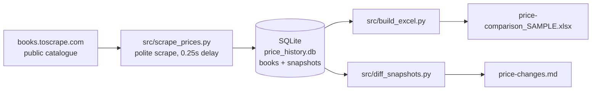

# P4 — E-commerce Price Tracker: Scrape Products & Prices → Price-Comparison Sheet

**Source:** books.toscrape.com (a site built for scraping practice) ·
**Snapshot:** 31 Oct 2026 · **Status: SAMPLE delivery on a public practice site**
**Tools:** Python (stdlib urllib + html.parser — no extra installs) · SQLite · Excel
**Deliverable:** `outputs/price-comparison_SAMPLE.xlsx` (1,000 books)
**Database:** `data/processed/price_history.db` (books + dated price snapshots)

> ⚠️ **What this is and is not.** This is a real scrape of a real public
> practice site, done politely (one request at a time, 0.25s apart,
> labelled User-Agent, public catalogue pages only, no login). It is
> **not** a real client's competitor data and no real shop's prices are
> claimed. For a real order, the same script points at the client's own
> competitor URLs — with the client's permission — and the comparison
> sheet is theirs. Scraping a site that forbids it, or a site behind a
> login, is never part of this service.

## Business question it answers

> "What are my competitors charging, and what changed since last time?"

A shop that checks competitor prices by hand checks a handful of items
once. This tracker checks a whole catalogue in one run, stores every
price with its date, and hands over a sortable comparison sheet — so
the next run shows price *changes*, not just today's prices.

## What is inside

| File | What it does |
|---|---|
| `outputs/price-comparison_SAMPLE.xlsx` | The deliverable: Comparison sheet (1,000 books, sorted by category then price) + Summary sheet with live formulas |
| `data/processed/price_history.db` | SQLite: `books` (one row per product) + `price_snapshots` (one row per product per run date) |
| `sql/schema.sql` | The price-history schema — a run on a new date adds a snapshot; history is never overwritten |
| `src/scrape_prices.py` | The scraper: category pagination, polite delays, retry once |
| `src/build_excel.py` | Builds the Excel sheet from the database |
| `src/diff_snapshots.py` | Compares the two latest snapshots → `outputs/price-changes.md` (price moves, new/removed, stock changes) |
| `src/checks.py` | Data-quality checks as code — 9 checks, all passing |
| `outputs/price-report.md` | What the snapshot shows, in plain English |

## 3 key findings (from this snapshot)

1. **Prices span £10.00–£59.99, average £35.07.** The cheapest book is
   *An Abundance of Katherines* (£10.00); the priciest is *The Perfect
   Play (Play by Play #1)* (£59.99). *So what:* a tracker that only
   watches bestsellers misses the whole price band — the sheet covers
   all 1,000, not a sample.
2. **Ratings are spread evenly, not gamed upward.** 1-star: 226 books,
   2-star: 196, 3-star: 203, 4-star: 179, 5-star: 196. *So what:* rating
   alone does not predict price here — the sheet keeps price and
   rating side by side so a buyer can see both before deciding.
3. **Everything is in stock in this snapshot (1,000/1,000).** That is
   normal for a demo catalogue and is exactly why the tracker stores
   availability per snapshot: on a real competitor site, an item going
   out of stock is often the first sign of a price move coming.

## Verified numbers

| KPI | Value |
|---|---|
| Books tracked | 1,000 |
| Categories | 50 |
| Snapshot date | 2026-10-31 |
| Cheapest price | £10.00 |
| Most expensive | £59.99 |
| Average price | £35.07 |
| 5-star books | 196 |
| In-stock books | 1,000 |

Verification: `python3 src/checks.py` (9 checks pass) plus an
independent reopen of the Excel file — 1,001 rows including the header,
and its min/max/average match the database exactly. One sample product
URL was also opened live and returned HTTP 200.

## How to run it (under 5 steps)

1. Open `outputs/price-comparison_SAMPLE.xlsx` — that is the deliverable.
2. To re-scrape: `python3 src/scrape_prices.py` (a run on a new date adds
   a dated snapshot; re-running on the same date refreshes that day's
   snapshot. After a second date exists, `python3 src/diff_snapshots.py`
   writes `outputs/price-changes.md` — the actual change report).
3. To rebuild the sheet: `python3 src/build_excel.py`.
4. To reuse it for a real client: change the start URL and category
   parsing in `src/scrape_prices.py` to the client's competitor pages
   (with permission), keep the database schema — the Excel builder
   needs no changes.
5. To check the data: `python3 src/checks.py`.

## Tools

- Python 3 standard library only (the scraper needs no pip installs)
- SQLite (price history) · openpyxl (Excel builder only)

## Data source note

**Public practice-site data, scraped 31 Oct 2026** (books.toscrape.com,
built for scraping practice). Book titles, prices and ratings belong
to that demo catalogue. This sample is labelled SAMPLE because the
tracker template — not the demo shop — is what a client buys.

## Limits

- One snapshot only (31 Oct 2026), so no price change is shown yet — the
  change report appears after a second run on another day.
- Prices are from a practice catalogue, not a real market — the range and
  ratings describe the demo site, not a real competitor.
- The scraper is written for this site's layout; a real client site needs
  its category parsing adjusted (step 4 above).

## Repo standard note

This paid project follows the portfolio repo standard (Master Plan
§3.2), slimmed for a scraping deliverable: README + data dictionary
(`data/README.md`) + the deliverable itself (Excel sheet) + the
price-history database + a Fiverr-ready package note
(`PACKAGE-NOTE.md`) + reproducible scripts. The raw scrape is the
database itself — nothing is hidden between scrape and sheet.
